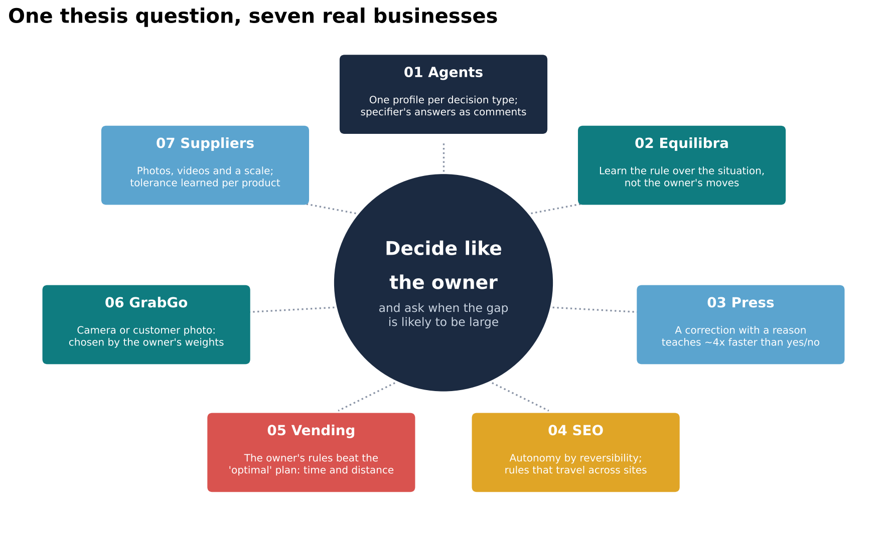
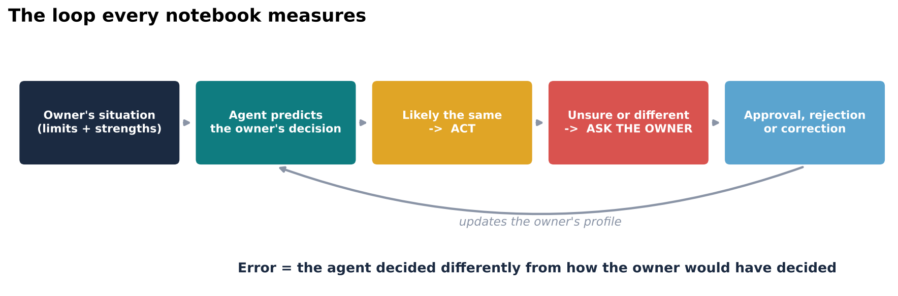

# Learning the Owner's Decision Profile

### Personalized decision-making and deferral for LLM agents, studied in seven real businesses

**Juan Antonio Sainz Gálvez** · B.Eng. Computer Engineering (Tecnológico de Monterrey) · Applied AI & Machine Learning, Conestoga College

I run small businesses in Canada and Mexico (vending machines, an image-based self-checkout, an AI connector for portfolio analysis, imports from China, and content channels) with a team of LLM agents and a few people. Before that I worked five years in SAP data migration and then founded and ran for eight years an LED distributor that grew to about 200 employees, with quality-inspection offices in Hong Kong and Shenzhen.

Running everything through agents taught me one lesson: **the agents follow my rules with me, and break them as soon as the situation or the person changes.** This portfolio turns that problem into a research question.

---

> **Thesis question.** How can LLM agents learn, from an owner's approvals, rejections and corrections, a **decision profile** grounded in the owner's personality and situation (constraints and strengths: economic, skills, cognitive, family and business), so that they **minimize the gap between the agent's decision and the decision the owner would have made**, across different types of decisions, as the owner evolves, and when other users operate the system on the owner's behalf, **deferring to the owner** whenever that gap is likely to be large?





---

## The seven notebooks

Each notebook takes one real business, reviews the research that applies to it, runs a reproducible experiment, and states one main finding. Every one measures the same thing: **how often the agent decides differently from the owner, and how often it has to ask him.**

| # | Notebook | The owner's decision the agent learns | Main finding | Open |
|---|---|---|---|---|
| 01 | [Learning the owner's decision profile](notebooks/01_owner_decision_profile.ipynb) | Sell, spend, publish, write to a client, deploy | One profile per decision type makes a third of the errors of a single profile and asks half as often. When a specifier's approvals train the agent, the specifier's profile silently replaces the owner's (9 vs 1 wrong decisions per 100). | [](https://colab.research.google.com/github/antoniosg2025-stack/applied-ai-research-portfolio/blob/main/notebooks/01_owner_decision_profile.ipynb) |
| 02 | [Equilibra: the owner's moves or the owner's rule?](notebooks/02_equilibra_situation_rules.ipynb) | How much money to put at risk | Copying the owner's moves misplaces about \$8,800 per user in other situations; learning his rule over the situation, with 13 well-chosen questions, decides for 1,000 users as he would. | [](https://colab.research.google.com/github/antoniosg2025-stack/applied-ai-research-portfolio/blob/main/notebooks/02_equilibra_situation_rules.ipynb) |
| 03 | [Press: corrections versus approvals](notebooks/03_press_corrections_vs_approvals.ipynb) | Publish a piece or not (real account data) | A correction with a reason teaches about 4× faster than yes/no. Weekly approval batches lose about 35% of the reach of approved pieces; publishing alone when confident cuts it to 12%. | [](https://colab.research.google.com/github/antoniosg2025-stack/applied-ai-research-portfolio/blob/main/notebooks/03_press_corrections_vs_approvals.ipynb) |
| 04 | [SEO: reversibility and rules that travel](notebooks/04_seo_reversibility_rule_transfer.ipynb) | Which changes need approval (real agent log) | Autonomy by reversibility cuts questions from 360 to 126; corrections that travel across sites, with one question about their scope, bring repeated rules to zero. | [](https://colab.research.google.com/github/antoniosg2025-stack/applied-ai-research-portfolio/blob/main/notebooks/04_seo_reversibility_rule_transfer.ipynb) |
| 05 | [Vending: the "optimal" plan versus the owner's rules](notebooks/05_vending_owner_rules_restock.ipynb) | What and when to restock | The owner's rules nearly double weekly margin after travel (\$83 → \$155) because they price his time and distance, which the planner ignored. Learning each correction once: 12 corrections instead of 150. | [](https://colab.research.google.com/github/antoniosg2025-stack/applied-ai-research-portfolio/blob/main/notebooks/05_vending_owner_rules_restock.ipynb) |
| 06 | [GrabGo: shelf camera, customer photo, or both?](notebooks/06_grabgo_images_owner_tradeoffs.ipynb) | Charge alone or ask; camera or not, per location | Pricing look-alikes the same cuts money lost to recognition errors by about 90% with no new hardware; the owner's privacy and cost weights choose a different setup for each location. | [](https://colab.research.google.com/github/antoniosg2025-stack/applied-ai-research-portfolio/blob/main/notebooks/06_grabgo_images_owner_tradeoffs.ipynb) |
| 07 | [Suppliers: phone photos, videos and a scale](notebooks/07_suppliers_phone_inspection_weight.ipynb) | Accept or reject a sample and a full order | Photos miss swapped components (about 13 lots a year ship); the scale catches them on the first lot; the owner's tolerance learned per product cuts disagreement from 15% to 2.5% of lots. | [](https://colab.research.google.com/github/antoniosg2025-stack/applied-ai-research-portfolio/blob/main/notebooks/07_suppliers_phone_inspection_weight.ipynb) |

## What the seven cases say together

1. **The profile is not the owner's actions; it is the reason behind them, conditioned on his situation** (02, 05). Copying moves fails as soon as the situation changes.
2. **The profile has structure**: it differs by decision type (01), by product (07), by location (06), and its rules have a scope (04).
3. **The form of feedback matters as much as the amount**: a correction with a reason is worth several approvals (03), and a correction learned once removes weeks of repetition (04, 05).
4. **Who gives the feedback matters**: approvals from someone else silently replace the owner's profile unless they are treated as comments (01).
5. **Asking is the learning step, not a failure**: the best agents ask few, well-chosen questions exactly where the owner's experience does not reach (02, 07).

## Key literature

Cooperative inverse reinforcement learning (Hadfield-Menell et al., 2016) · Personalized RLHF with variational preference learning (Poddar et al., 2024) · The PRISM alignment dataset (Kirk et al., 2024) · LaMP (Salemi et al., 2024) · Generative agent simulations of 1,000 people (Park et al., 2024) · Learning to defer (Madras et al., 2018; Mozannar & Sontag, 2020) · Bounded rationality (Simon, 1955) · Concept drift (Gama et al., 2014). Each notebook lists its own references.

## Data and reproducibility

- Each notebook is generated by a script in `tools/` (`build_nb1.py` … `build_nb7.py`) and executed end to end; `tools/build_assets.py` draws the infographics.
- Real data in `data/`: post metrics of the Press accounts (no post text, no names), the GrabGo English-versus-Spanish test, and the SEO agent's first-week decision log. Everything else is simulated and calibrated to my operations; illustrative amounts are marked as such. No customer data, keys or private code is included.

```
pip install -r requirements.txt
jupyter notebook notebooks/
```
